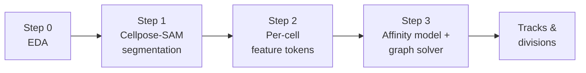

# Biohub — Cell Tracking During Development

> Detect, track, and link cells across time in 3D microscopy data — including cell divisions and lineage reconstruction.

[](https://www.kaggle.com/competitions/biohub-cell-tracking-during-development/overview)

## Table of Contents

- [Overview](#overview)
- [The Three Core Questions](#the-three-core-questions)
- [Data](#data)
- [Pipeline](#pipeline)
  - [Step 0 — EDA](#step-0--eda)
  - [Step 1 — Cellpose-SAM Segmentation](#step-1--cellpose-sam-segmentation)
  - [Step 2 — Cell Token Design](#step-2--cell-token-design)
  - [Step 3 — Learned Affinity + Graph Solver](#step-3--learned-affinity--graph-solver)
- [Repository Layout](#repository-layout)

## Overview

This repository holds the working plan and notebooks for the Kaggle competition
[**Biohub – Cell Tracking During Development**](https://www.kaggle.com/competitions/biohub-cell-tracking-during-development/overview).

The goal is to develop algorithms that detect cells in 3D fluorescence microscopy volumes, track
them through time, and reconstruct their lineages — including mitosis (division) events.

## The Three Core Questions

The design answers three questions:

1. **How do we recognize cell identity from voxels?**
2. **How do we track a cell as time passes?**
3. **How do we recognize a mitosis (division) event?**

### 1. Cell identity from voxels

[Step 1](#step-1--cellpose-sam-segmentation) (Cellpose-SAM instance segmentation) produces
per-timepoint candidate instances. [Step 2](#step-2--cell-token-design) (feature tokens) gives each
instance a descriptor: image embedding, morphology, fluorescence/intensity statistics, and position.

Together these answer *"what is a cell at this instant"* — but **not** identity persistence across
time. That is [Step 3](#step-3--learned-affinity--graph-solver)'s job.

### 2. Tracking as time passes

A transformer alone does not perform assignment — it needs a decision layer on top of its scores.

A small model scores pairwise affinity between cell tokens in consecutive (or nearby) frames; those
scores become edge weights fed into `tracksdata`'s graph solver, which actually produces the linked
graph. Candidate edges are restricted to the competition's **7 µm physical radius**
(`DistanceEdges`), the same cutoff as the evaluation metric — this keeps the search space small and
consistent with how the submission is scored.

### 3. Recognizing mitosis

A plain 1-to-1 bipartite tracker cannot produce divisions by construction. Two options:

| | Approach | Notes |
| --- | --- | --- |
| **(a)** | **MVP** — configure the solver with `max_children=2` | Same as the classical baseline. Divisions emerge wherever the learned affinity supports two roughly equally good daughters. |
| **(b)** | **Refinement** — explicit division-probability head on cell tokens | Trained on ground-truth division labels to bias the solver toward keeping 2 edges only at true division points. |

Divisions are rare, so relying purely on emergent behavior from a generic affinity threshold risks
over- or under-predicting them. **Start with (a), layer in (b) once the MVP tracker works.**

## Data

Facts that shape the design:

- **Each sample** is a zarr v3 array of shape `(T=100, Z=64, Y=256, X=256)`, `uint16`, single
  fluorescence channel.
- **Physical voxel scale** is `z = 1.625 µm`, `y = x = 0.40625 µm` → roughly **4× anisotropy in z**.
  This exact scale is also used by the competition's evaluation metric.
- **Ground truth** is a `geff` zarr group:

  ```text
  nodes/ids                     (N,)   uint64
  nodes/props/{t,z,y,x}/values  (N,)   int64 each
  edges/ids                     (E, 2) uint64   # (source, target)
  ```

## Pipeline



### Step 0 — EDA

📓 [`notebook_github/0_EDA.ipynb`](notebook_github/0_EDA.ipynb)

Exploratory data analysis of the raw data using two example datasets.

### Step 1 — Cellpose-SAM Segmentation

📓 [`notebook_github/01_cellpose_sam_segmentation.ipynb`](notebook_github/01_cellpose_sam_segmentation.ipynb)

1. Reuse the existing geff/zarr loading pattern from
   [`notebook_github/0_EDA.ipynb`](notebook_github/0_EDA.ipynb).
2. Run Cellpose-SAM on a small local subset first (one sample each from `44b6` and `6bba`, a handful
   of timepoints / a cropped subvolume) to validate pipeline logic on CPU in reasonable time.
3. Run in 3D mode, explicitly accounting for the ~4× z-anisotropy — either pass the real voxel
   spacing to Cellpose or resample z closer to isotropic. Decide empirically by comparing mask
   quality.
4. Validate against geff: match predicted mask centroids to ground-truth node centroids per labeled
   frame using the same scaled-distance bipartite matching as the official metric
   (`linear_sum_assignment`, Euclidean distance in physical microns using the
   `[1.625, 0.40625, 0.40625]` scale, 7.0 µm cutoff). Compute per-frame TP/FP/FN →
   precision/recall/F1, reported separately for `44b6` vs `6bba`.

> [!NOTE]
> **Success criterion:** the notebook runs end-to-end and produces detection precision/recall numbers
> per dataset regime. No fixed target threshold yet — the numbers are the artifact to review before
> deciding whether to tune Cellpose-SAM (diameter, flow threshold, etc.) or move on to Step 2.

### Step 2 — Cell Token Design

📓 [`notebook_github/02_cell_tokens.ipynb`](notebook_github/02_cell_tokens.ipynb)

Each cell instance becomes a token:

```text
Z_{i,t} = [e_image, e_fluorescence, e_morphology, x, y, z, t]
```

| Component | Definition |
| --- | --- |
| `e_morphology` | `skimage.measure.regionprops_table` on the mask, computed in **physical units** (respecting anisotropic voxel size): volume, surface area, elongation, sphericity, solidity. |
| `e_fluorescence` | The data is single-channel, so this is intensity statistics within the mask (mean/std/percentiles, integrated intensity) — **not** multi-channel unmixing. Named to match the original proposal, but it is really "intensity features." |
| `e_image` | Reuse Cellpose-SAM's own ViT-based (SAM) image embeddings, extracted per predicted cell instance. **The MVP should not train a new image encoder from scratch.** Fallback: a handcrafted placeholder (e.g. patch intensity histogram) so the Step 3 pipeline can be validated end-to-end first. |
| `position` / `time` | Mask centroid in physical microns + frame index — already available from the segmentation output. |

### Step 3 — Learned Affinity + Graph Solver

📓 [`notebook_github/03_tracking_solver.ipynb`](notebook_github/03_tracking_solver.ipynb)

1. **Candidate edges** — `tracksdata.edges.DistanceEdges` at the competition's 7 µm physical radius
   (reuses the same proven mechanism as the classical baseline).
2. **Affinity model** — a small MLP/transformer scores pairs `(Z_{i,t}, Z_{j,t+1})` for candidate
   edges, trained on ground-truth edges as positives and other candidates as negatives. Because
   ground truth is temporally sparse, mask the loss to only frame-pairs/regions where both frames
   have ground-truth nodes.
3. **Solving** — feed learned scores as edge weights into a `tracksdata` solver configured with
   `max_children=2` (allows divisions), rather than strict 1-to-1 matching.

   > [!IMPORTANT]
   > Check the installed `tracksdata` package (PyPI, since the old local editable checkout is gone)
   > for which solver variants accept externally-supplied edge weights vs. only raw distance.
4. **Division handling** — the MVP relies on the solver's `max_children=2` policy (as the baseline
   did). Refinement: an explicit division-probability auxiliary head per cell token, trained on
   ground-truth division labels, to suppress spurious 2-child assignments from noisy affinity ties.

## Repository Layout

```text
.
├── notebook_github/
│   ├── Overview.ipynb                      # Full competition narrative
│   ├── 0_EDA.ipynb                         # Step 0 — exploratory data analysis
│   ├── 01_cellpose_sam_segmentation.ipynb  # Step 1 — segmentation
│   ├── 02_cell_tokens.ipynb                # Step 2 — per-cell feature tokens
│   ├── 03_tracking_solver.ipynb            # Step 3 — affinity model + graph solver
│   └── Prac_20260723_analysis.ipynb        # geff/zarr loading patterns
├── CLAUDE.md                               # Condensed operational facts
└── README.md
```
